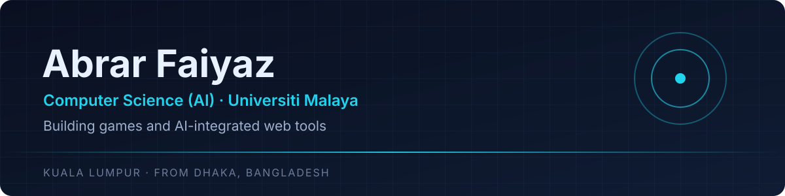

  
  
  

## About me

I'm a first-year **Bachelor of Computer Science (Artificial Intelligence)** student at **Universiti Malaya** (October 2026 intake), originally from Dhaka, Bangladesh.

I'm building a Roblox game with a friend, and I'm working toward AI-integrated websites and tools. I work alongside AI coding tools like Claude Code, and I'm learning the fundamentals underneath (Java, Python and data science) through my degree.

- **Focus:** AI engineering and AI-integrated web apps
- **Also exploring:** cybersecurity (white-hat)
- **Long-term path:** UM BSc, then a Master's in AI

## What I'm building

| Project | What it is | Built with | Status |
|---|---|---|---|
| **Project Nest** | A casual phone + PC Roblox game by **Billah Studios**. You sneak past guards, steal eggs and hatch creatures, across four biomes with bosses and a night event. | Luau · Rojo · Roblox Studio | Milestones M0–M6.4 shipped |

> The game's repo is private while it's in development. Websites and tools I build will be added here as they go live.

## University work

Coursework from my UM degree lives here too. Repos for graded work stay **private until the assessment is over**, so they don't break academic-integrity rules.

**Semester 1 (2026/27):**

- WIX1002 Fundamentals of Programming (Java)
- WIA1007 Introduction to Data Science
- WIX1001 Computing Mathematics I
- WIX1003 Computer Systems & Organization

## Tech

**Learning through my degree**

**Used in my projects**

**Currently learning for web projects:** Vercel (hosting) and Supabase (database, logins, storage)

**AI tools:** Claude Code

## How I work

- Every project goes in Git from day one and gets pushed to a remote
- I build in small phases and test each one before moving on
- No keys or passwords in any repo, ever

## Contact

The easiest way to reach me is [LinkedIn](https://www.linkedin.com/in/abrar-faiyaz-haque-adir-12490a405).
